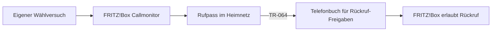

# Rufpass

**Wer von dir angerufen wird, darf zurückrufen.**

Rufpass soll selbst gewählte Telefonnummern automatisch für Rückrufe an der
FRITZ!Box freigeben. Für alle anderen unbekannten Nummern bleibt die bestehende
Sperrregel aktiv.

## Warum Rufpass?

Nur Anrufe aus dem Telefonbuch zuzulassen bringt Ruhe vor Werbeanrufen. Es verhindert
aber auch erwünschte Rückrufe: Du rufst eine Werkstatt, Arztpraxis oder einen neuen
Kontakt an, erreichst niemanden und der spätere Rückruf wird blockiert.

Rufpass soll diese Lücke schließen, ohne dass jede selbst gewählte Nummer dauerhaft
in deinem persönlichen Telefonbuch landen muss.

> **Entwicklungsstand: Konzept und technische Vorbereitung.** Es gibt noch keinen
> lauffähigen Dienst. Die folgenden Funktionen beschreiben das geplante Verhalten.
> Die Rufbehandlung mit einem zweiten Telefonbuch muss zuerst am Gerät bestätigt werden.

## So soll es funktionieren

1. **Du rufst jemanden an.** Rufpass erkennt bereits den Wählversuch, auch wenn niemand abnimmt.
2. **Die Nummer bekommt einen Rufpass.** Der Dienst speichert sie in einem separaten
   lokalen FRITZ!Box-Telefonbuch für Rückruf-Freigaben.
3. **Der Rückruf darf klingeln.** Die FRITZ!Box übernimmt weiterhin die Rufbehandlung.
4. **Die Freigabe läuft wieder ab.** Geplant sind zeitlich begrenzte Einträge;
   30 Tage sind der erste Entwurf. Erneutes Wählen verlängert die Freigabe.

Persönliche Kontakte sollen unverändert bleiben. Rufpass soll ausschließlich die
eigenen automatisch angelegten Einträge verwalten.

## Technischer Ansatz

Ein kleiner Python-Hintergrunddienst soll auf einem dauerhaft laufenden Rechner im
Heimnetz arbeiten. Der Callmonitor der FRITZ!Box meldet Wählversuche über TCP-Port
1012. Die authentifizierte TR-064-Schnittstelle dient zur Verwaltung des zusätzlichen
Telefonbuchs. SQLite speichert Freigaben und Ablaufzeiten lokal.

Für den Betrieb sind Docker Compose oder unter Linux systemd vorgesehen. Ein
Cloud-Dienst, MQTT-Broker oder Reverse Proxy ist für die Kernfunktion nicht erforderlich.

## Voraussetzungen und Kompatibilität

- Eine FRITZ!Box mit Telefoniefunktion, Callmonitor und passenden TR-064-Aktionen.
- Eine bestehende Sperrregel für Anrufer ohne Telefonbucheintrag.
- Ein zusätzliches **lokales** Telefonbuch sowie ein Benutzer mit Telefonie-Rechten.
- Ein dauerhaft laufender Rechner mit Netzwerkzugriff auf die FRITZ!Box.

**Erstes vorgesehenes Testgerät:** FRITZ!Box 7690 mit FRITZ!OS 8.25.
Die Kompatibilität ist noch nicht am Gerät bestätigt; weitere Modelle sind noch nicht getestet.

## Rechte und Grenzen

Ein eigener FRITZ!Box-Benutzer benötigt Telefonie-Rechte (Phone). Diese sind nicht
auf ein einzelnes Telefonbuch begrenzbar. Die Einschränkung auf die Ziel-Telefonbuch-ID
soll im Programm umgesetzt werden; sie ersetzt keine Berechtigungsgrenze der Box.

- Erfasst werden ausschließlich Anrufe, die über die überwachte FRITZ!Box laufen.
- Rückrufe von einer anderen oder unterdrückten Nummer werden nicht freigegeben.
- Während eines Ausfalls verpasste erfolglose Wählversuche lassen sich nicht
  zuverlässig aus der normalen Anrufliste nachholen.
- Bereits angelegte Telefonbucheinträge bleiben bei einem Dienstausfall bestehen.
- Zugangsdaten und echte Telefonnummern gehören nicht ins Repository oder in Fehlerberichte.

## Nächste Schritte

- [ ] Verhalten der Sperrregel mit einem zweiten Telefonbuch bestätigen.
- [ ] Wählereignisse am Callmonitor prüfen.
- [ ] Erfassung und Nummernnormalisierung implementieren.
- [ ] Gezielte Telefonbuchpflege und Ablaufverwaltung implementieren.
- [ ] Probelauf, automatisierte Tests und Gerätetests durchführen.
- [ ] Betrieb und Installation dokumentieren.

## Dokumentation und Mitarbeit

- [Architektur und Implementierungsgrenzen](docs/architecture.md)
- [Manueller Vorabtest und nächste Schritte](docs/setup.md)
- [Recherche und Quellen](docs/research.md)
- [Mitwirken und Fehler melden](CONTRIBUTING.md)

## Autor

Ein Projekt von [Maximilian Glas](https://github.com/maxglas).

Rufpass ist ein unabhängiges Projekt und kein offizielles Produkt von FRITZ!.

## Lizenz

Die Lizenz wird vor der öffentlichen Freigabe festgelegt und als `LICENSE` ergänzt.
