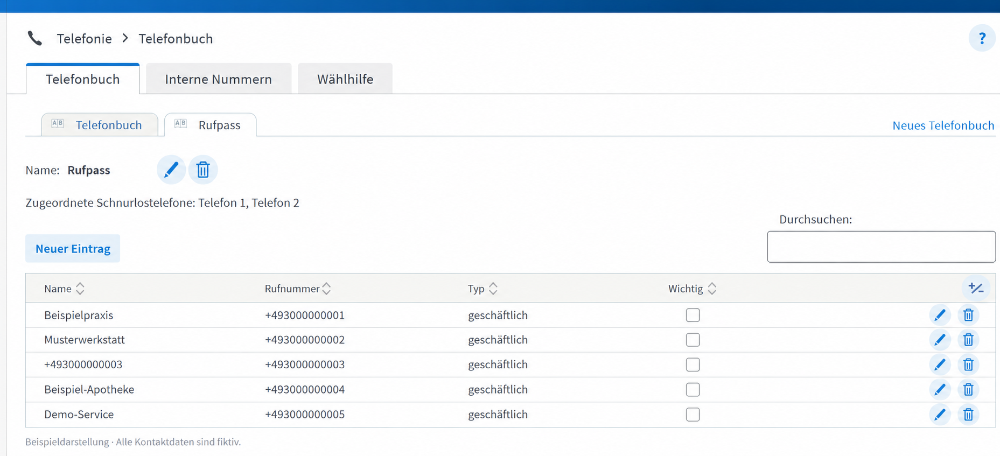
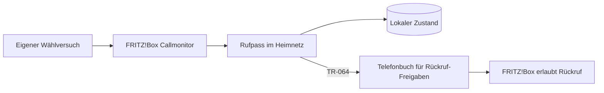

# Rufpass

**Wer von dir angerufen wird, darf zurückrufen.**

Rufpass erkennt selbst gewählte Telefonnummern an der FRITZ!Box und trägt sie für
eine begrenzte Zeit in ein zusätzliches Telefonbuch ein. Mit der vorhandenen
Sperrregel „Nicht im Telefonbuch“ dürfen diese Nummern zurückrufen.



*Beispieldarstellung mit ausschließlich fiktiven Kontaktdaten.*

## Warum Rufpass?

Nur Anrufe aus dem Telefonbuch zuzulassen bringt Ruhe vor Werbeanrufen. Es verhindert
aber auch erwünschte Rückrufe: Du rufst eine Werkstatt, Arztpraxis oder einen neuen
Kontakt an, erreichst niemanden und der spätere Rückruf wird blockiert.

Rufpass ergänzt deine vorhandene Positivliste automatisch. Persönliche Kontakte
bleiben erhalten und müssen nicht durch vorübergehende Kontakte ergänzt werden.

## Systeme und Laufzeit

Rufpass ist eine Python-Anwendung für Rechner im Heimnetz. Auf dem Rechner werden
**Python 3.12 oder neuer** und die mit pip installierten Projektabhängigkeiten benötigt.
Linux, etwa auf einem Mini-PC oder **Raspberry Pi**, ist als Dauerläufer geeignet.
Auch **Windows** kann den Python-Prozess ausführen. Der mitgelieferte Dienstinstaller
und die ausführliche Anleitung beziehen sich auf **Linux/Ubuntu mit systemd**;
sie sind keine Beschränkung der Python-Anwendung auf Ubuntu.

Auf Router-Seite ist eine **FRITZ!Box mit Telefonie, Callmonitor, TR-064 und lokalen
Telefonbüchern** erforderlich. Die aktuelle Anleitung orientiert sich an **FRITZ!OS 8.x**.
Entscheidend sind diese Funktionen, nicht das Modell 7690. Andere Modelle und
FRITZ!OS-Stände sind nicht pauschal als getestet zu verstehen.

**Tatsächlich am Gerät geprüft:** FRITZ!Box 7690, FRITZ!OS 8.25, Ubuntu 24.04.4 LTS,
Python 3.12.3. Andere Router, Raspberry Pi und der vollständige Windows-Betrieb
sind noch nicht am Gerät geprüft. Lokale Windows-Tests verwenden simulierte Router.

## Installation auf Linux/Ubuntu

### 1. FRITZ!Box vorbereiten

**Zusätzliches Telefonbuch anlegen.** Unter **Telefonie → Telefonbuch** ein neues
**lokales** Telefonbuch namens `Rufpass` erstellen. Ein anderer Name ist möglich,
muss dann bei der Einrichtung exakt angegeben werden. Das bisherige Telefonbuch
bleibt bestehen. **Der Installer erstellt das Telefonbuch nicht automatisch.**
Die Telefonbuch-ID muss größer als 0 sein; normalerweise erhält das zweite Buch ID 1.
Die vorhandene Rufsperre für unbekannte Anrufer muss Nummern aus diesem Buch zulassen.

**Eigenen FRITZ!Box-Benutzer anlegen.** Unter **System → FRITZ!Box-Benutzer → Benutzer
hinzufügen** einen aktiven Benutzer `rufpass` mit eigenem Kennwort erstellen. Die
benötigte Berechtigung heißt **Sprachnachrichten, Faxnachrichten, FRITZ!App Fon und
Anrufliste**. Zusätzliche Rechte für allgemeine FRITZ!Box-Einstellungen, NAS oder
Smart Home sind dafür nicht erforderlich. Bei der Installation wird das Kennwort
**dieses Benutzers** abgefragt; das allgemeine FRITZ!Box-Kennwort wird nicht benötigt.
Die Telefonie-Rechte lassen sich an der Box nicht auf das zusätzliche Buch begrenzen;
Rufpass beschränkt seine Änderungen selbst auf dieses Buch.

**Anwendungszugriff prüfen (normalerweise bereits aktiv).** TR-064 ist die
Programmierschnittstelle der FRITZ!Box. Rufpass meldet sich dort mit dem eingerichteten
Benutzer an, liest Telefonbücher und verwaltet die eigenen Freigabeeinträge. In den
Werkseinstellungen ist der Zugriff für Anwendungen üblicherweise schon erlaubt.
Wenn der Telefonbuchzugriff funktioniert, ist keine zusätzliche Freigabe nötig.
Nur falls die Option deaktiviert wurde, in den Netzwerkeinstellungen **Zugriff für
Anwendungen/Apps erlauben** einschalten. Das ist eine lokale Schnittstellenfreigabe,
keine Portweiterleitung ins Internet. [FRITZ!-Anleitung](https://fritz.com/apps/knowledge-base/myfritz-app/3266_myfritz-app-fur-android-einrichten)

**Callmonitor freigeben.** Der Callmonitor ist eine eingebaute FRITZ!Box-Schnittstelle,
die laufende Telefonie-Ereignisse wie Klingeln, Wählbeginn und Auflegen mit Rufnummern
meldet. Rufpass braucht den **Wählbeginn**, damit auch erfolglose Anrufe eine Rückruf-Freigabe
erzeugen. Aktiviert wird er einmalig durch Wählen von **`#96*5*`** an einem direkt
mit der FRITZ!Box verbundenen Telefon. Auf dem Rechner wird dafür nichts zusätzlich installiert.

**Was diese Freigabe bedeutet:** Der Callmonitor stellt Anrufmetadaten über **TCP 1012**
ohne eigene Benutzeranmeldung bereit; er überträgt keine Gesprächsinhalte.
Wer diesen Port im Netz erreichen kann, kann diese Telefonie-Ereignisse mitlesen.
Das Kennwort des Benutzers `rufpass` schützt diesen separaten Zugang nicht.
Nur im vertrauenswürdigen Heimnetz verwenden und keine Portweiterleitung ins Internet
einrichten. Mit `#96*4*` lässt sich der Callmonitor wieder abschalten; dann kann
Rufpass keine neuen Wählversuche erkennen.

Die [ausführlichen Voraussetzungen](docs/prerequisites.md) erläutern Netzwerkzugriff
und Einstellungen. Telefonbuch, Benutzer und Freigaben werden **manuell vorbereitet**;
der Installer prüft deren Erreichbarkeit, richtet sie aber nicht in der Box ein.

### 2. Python und Systempakete vorbereiten

Auf Linux Python **3.12 oder neuer** bereitstellen. Für die folgende Ubuntu-Anleitung
werden außerdem systemd und `sudo`-Berechtigung vorausgesetzt. Ubuntu 24.04 ist die
bisher am Gerät verwendete Distribution, nicht die einzige mögliche Linux-Plattform.
Auch ein Raspberry Pi benötigt ein Betriebssystem mit passender Python-Version.

Systempakete auf Ubuntu einmalig installieren:

```bash
sudo apt update
sudo apt install -y git python3 python3-venv ca-certificates
python3 --version
```

Die [vollständigen Voraussetzungen](docs/prerequisites.md) erklären die FRITZ!Box-Einstellungen,
Benutzerrechte und Netzwerkanforderungen. Es wird nichts auf der FRITZ!Box installiert.

### 3. Rufpass-Code und Dienst installieren

Neuer Checkout:

```bash
git clone https://github.com/maxglas/Rufpass.git
cd Rufpass
sudo bash scripts/install.sh
```

Bereits vorhandener Checkout:

```bash
cd /pfad/zum/Rufpass
git pull --ff-only
sudo bash scripts/install.sh
```

`/pfad/zum/Rufpass` durch das eigene Projektverzeichnis ersetzen. Das öffentliche
Repository kann über HTTPS ohne GitHub-Anmeldung geklont und aktualisiert werden.

Die Ersteinrichtung fragt Host und Benutzer ab, **direkt danach das Kennwort dieses
Benutzers**, anschließend Telefonbuchname und -ID, Landes-/Ortsvorwahl und Gültigkeit. Standard: Buch **Rufpass**, ID **1**,
Benutzer **rufpass**, **365 Tage** Gültigkeit. Die Ortsvorwahl muss zum eigenen Anschluss passen.

Der Installer prüft die vorbereitete Laufzeit, installiert Rufpass samt Python-Abhängigkeiten
in eine eigene Umgebung und richtet einen systemd-Dienst mit eigenem Linux-Benutzer ein.
Er aktiviert Autostart und startet die Freigabeverwaltung direkt. Die frühere Projekt-`.venv`
wird dafür nicht verwendet. Updates erfolgen mit `git pull --ff-only` und demselben Installer;
gespeicherte Konfiguration und Freigabedaten bleiben erhalten.

### 4. Dienst und Rückruf prüfen

```bash
sudo systemctl status rufpass --no-pager
sudo systemctl is-enabled rufpass
sudo journalctl -u rufpass -n 30 --no-pager
```

Erwartung: `active (running)`, `enabled` und ein verbundener Callmonitor ohne
wiederkehrende Telefonbuchfehler. Danach eine eigene, noch nicht gespeicherte
Testnummer vom Festnetz wählen, den neuen Kontakt kontrollieren und zurückrufen lassen.
Ein alter, manuell stehen gelassener Entwicklungstestkontakt dieser Nummer muss
für diese Prüfung zuerst in der Box entfernt werden.

Details zu [Ersteinrichtung, Konfiguration, Updates und Betrieb](docs/operations.md).

## So funktioniert es

1. **Du rufst jemanden an.** Rufpass erkennt den Wählbeginn, auch wenn niemand abnimmt.
2. **Eine Freigabe wird angelegt.** Neue Nummern erscheinen als normale Kontakte im
   zusätzlichen Telefonbuch. Ein unbekannter Name wird durch die **Rufnummer allein**
   ersetzt, damit der Rückruf im Display zugeordnet werden kann.
   Vorher werden alle lesbaren FRITZ!Box-Telefonbücher abgeglichen. Bereits bekannte
   Nummern werden nicht zusätzlich angelegt, auch bei unterschiedlicher Schreibweise.
3. **Der Rückruf darf klingeln.** Die FRITZ!Box übernimmt weiterhin die Rufbehandlung.
4. **Die Freigabe läuft ab.** Standardmäßig nach 365 Tagen seit dem letzten eigenen
   Wählversuch. Erneutes Wählen verlängert sie ohne doppelten Eintrag.



Rufpass speichert Wählversuche vor Telefonbuchänderungen in SQLite. Nach Fehlern
gleicht der Dienst seine Kennungen mit dem Telefonbuch ab, bevor er neue Einträge
anlegt. Abgelaufene Kontakte werden nur gelöscht, wenn sie weiterhin eindeutig
zum gespeicherten Rufpass-Eintrag passen. Manuell veränderte Kontakte bleiben erhalten.

Mit `reverse_lookup = true` kann Rufpass für neue unbekannte Nummern eine kostenlose
Rückwärtssuche bei [Wikidata](https://www.wikidata.org/) versuchen. Ein eindeutiger
Treffer ergibt beispielsweise `Beispielmuseum`. Ohne eindeutigen Namen steht nur
die normalisierte Rufnummer im Namensfeld, etwa `+49…`. Der Anzeigename enthält
keinen Rufpass-/Datumspräfix, damit Name oder Rufnummer im Telefon-Display Platz haben.
Leere Namen sind am Gerät nicht bestätigt, daher wird die Rufnummer als Rückfall
verwendet. Das Anlegedatum bleibt intern gespeichert. Bestehende Kontakte
werden nicht nachträglich umbenannt. Dazu werden die Rufnummer und die öffentliche IP an den Dienst
übertragen. Die Suche ist standardmäßig eingeschaltet; mit `reverse_lookup = false`
lässt sie sich abschalten. Wikidata ist kein vollständiges Telefonverzeichnis: Viele Betriebe und private Nummern liefern keinen Treffer.

## Stand und Kompatibilität

**Version 0.2.5:** Automatische Freigaben, Ablaufverwaltung, Wiederanlauf und
Ubuntu-Installer sind implementiert und mit simulierten Schnittstellen getestet.
Die Installation als systemd-Dienst und der laufende Betrieb auf Ubuntu sind vom
Betreiber am 27.10.2026 als einwandfrei bestätigt. Diese Version bleibt ein früher
Teststand; ein vollständiger 365-Tage-Ablauf ist damit nicht nachgewiesen. Ein erfolgreicher
Live-Namenstreffer bei Wikidata ist noch nicht bestätigt; bisher traten Timeout/HTTP 502 auf.

Am Gerät bestätigt: FRITZ!Box **7690**, FRITZ!OS **8.25**, Ubuntu **24.04.4 LTS**,
Python **3.12.3**. Geprüft wurden das Durchstellen von Nummern aus dem zweiten Buch,
Telefonbuchzugriff, Live-Wählereignisse sowie Anlegen, Rücklesen, Entfernen und
sichtbares Behalten eines Testkontakts. Andere Modelle sind nicht getestet.

Die automatische Nummernaufbereitung ist zunächst auf deutsche Anschlüsse mit
konfigurierter Ortsvorwahl ausgerichtet; internationale Nummern werden mit `+`
oder `00` erkannt. Interne Nummern, Steuercodes, kurze Dienstnummern und ausgewählte
deutsche Sonderrufnummern werden übersprungen. Eine weltweite Rufnummernvalidierung
ist nicht enthalten. Ein fertiger Windows-Dienstinstaller, Docker-Paket und
Weboberfläche gehören nicht zu dieser Version. Zur manuellen Python-Ausführung
unter Windows gibt es einen [kurzen Einstieg](docs/windows.md).

## Rechte, Daten und Grenzen

- Ein FRITZ!Box-Benutzer benötigt Telefonie-Rechte. Diese lassen sich an der Box
  nicht auf ein einzelnes Telefonbuch begrenzen; Rufpass begrenzt seine Schreibzugriffe selbst.
- Der Dienst verwaltet nur eigene Einträge im konfigurierten zusätzlichen Buch.
  Telefonbücher werden niemals komplett ersetzt oder wiederhergestellt.
- Rufnummern und Ablaufdaten liegen lokal in SQLite; Zugangsdaten in einer Datei,
  die bei der Ubuntu-Dienstinstallation nur root und der Dienstbenutzer lesen können.
  Unter Windows liegen die Dateien im Profil des ausführenden Benutzers; dort gelten die Windows-Dateirechte. Normale Logs enthalten keine Telefonnummern.
- Erfasst werden nur Telefonate über die überwachte FRITZ!Box. Andere oder unterdrückte
  Rückrufnummern werden dadurch nicht bekannt. Andere vorhandene Rufsperren gelten weiterhin.
- Während Rufpass aus ist, verpasste Wählversuche können nicht nachgeholt werden.
  Bereits gespeicherte Freigaben bleiben bei einem Ausfall bestehen; ihre Bereinigung wartet
  auf den nächsten erfolgreichen Dienstlauf.
- Manuelle Kontakte und frühere Entwicklungstestkontakte werden nicht nachträglich
  als automatisch verwaltete Freigaben übernommen.

## Diagnose und Dokumentation

`check` und `monitor` bleiben rein lesend. Automatische Freigaben führt der neue
Befehl `run` aus; der Installer richtet diesen als Dienst ein.

- [Änderungen nach Version](CHANGELOG.md)
- [Voraussetzungen an FRITZ!Box und Rechner](docs/prerequisites.md)
- [Manuelle Python-Ausführung unter Windows](docs/windows.md)
- [Installation, Betrieb, Konfiguration und Fehlerbehebung](docs/operations.md)
- [Lesende Betriebsdiagnose](docs/diagnostics.md)
- [Architektur](docs/architecture.md)
- [Architekturentscheidung: Python](docs/adr-001-python.md)
- [Recherche und Quellen](docs/research.md)
- [Mitwirken und Tests](CONTRIBUTING.md)
- [Sicherheitsprobleme melden](SECURITY.md)
- [Vorbereitung der öffentlichen Veröffentlichung](docs/github.md)

## Autor

Ein Projekt von [Maximilian Glas](https://github.com/maxglas).
Rufpass ist ein unabhängiges Projekt und kein offizielles Produkt von FRITZ!.

## Lizenz

Rufpass ist **Source Available** unter **Apache-2.0 mit Commons Clause v1.0**.
Nutzung und Anpassung im eigenen Betrieb sind erlaubt. Entgeltliche Angebote,
deren Wert ganz oder wesentlich aus Rufpass stammt, sind durch die Commons Clause
eingeschränkt. Maßgeblich ist [LICENSE](LICENSE); eine verständliche Zusammenfassung
steht unter [Lizenz und Nutzung](docs/licensing.md).
