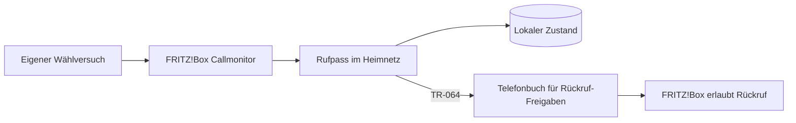

# Rufpass

**Wer von dir angerufen wird, darf zurückrufen.**

Rufpass erkennt selbst gewählte Telefonnummern an der FRITZ!Box und trägt sie für
eine begrenzte Zeit in ein zusätzliches Telefonbuch ein. Mit der vorhandenen
Sperrregel „Nicht im Telefonbuch“ dürfen diese Nummern zurückrufen.

## Warum Rufpass?

Nur Anrufe aus dem Telefonbuch zuzulassen bringt Ruhe vor Werbeanrufen. Es verhindert
aber auch erwünschte Rückrufe: Du rufst eine Werkstatt, Arztpraxis oder einen neuen
Kontakt an, erreichst niemanden und der spätere Rückruf wird blockiert.

Rufpass ergänzt deine vorhandene Positivliste automatisch. Persönliche Kontakte
bleiben erhalten und müssen nicht durch vorübergehende Kontakte ergänzt werden.

## Installation auf Ubuntu

### 1. Voraussetzungen vorbereiten

- Ubuntu **24.04 LTS**, Python **3.12 oder neuer**, systemd und `sudo`-Berechtigung.
- Zusätzliches lokales FRITZ!Box-Telefonbuch, beispielsweise `Rufpass`, mit ID größer 0.
- FRITZ!Box-Benutzer mit Telefonie-Rechten und erlaubtem Zugriff für Anwendungen (TR-064).
- Callmonitor durch einmaliges Wählen von `#96*5*` an einem verbundenen Telefon aktivieren.
- Die vorhandene Positivliste muss Nummern aus dem zusätzlichen Telefonbuch durchlassen.

Systempakete auf Ubuntu einmalig installieren:

```bash
sudo apt update
sudo apt install -y git python3 python3-venv ca-certificates
python3 --version
```

Die [vollständigen Voraussetzungen](docs/prerequisites.md) erklären die FRITZ!Box-Einstellungen,
Benutzerrechte und Netzwerkanforderungen. Es wird nichts auf der FRITZ!Box installiert.

### 2. Rufpass-Code und Dienst installieren

Neuer Checkout:

```bash
git clone https://github.com/maxglas/Rufpass.git
cd Rufpass
sudo bash scripts/install.sh
```

Bereits vorhandener Checkout:

```bash
cd /pfad/zum/Rufpass
git pull --ff-only
sudo bash scripts/install.sh
```

`/pfad/zum/Rufpass` durch das eigene Projektverzeichnis ersetzen. Solange das
Repository privat ist, erfordert das Klonen/Pullen eine GitHub-Anmeldung.

Die Ersteinrichtung fragt Host, Benutzer, Telefonbuchname und -ID, Landes-/Ortsvorwahl,
Gültigkeit und Kennwort im lokalen Terminal ab. Standard: Buch **Rufpass**, ID **1**,
Benutzer **rufpass**, **365 Tage** Gültigkeit. Die Ortsvorwahl muss zum eigenen Anschluss passen.

Der Installer prüft die vorbereitete Laufzeit, installiert Rufpass samt Python-Abhängigkeiten
in eine eigene Umgebung und richtet einen systemd-Dienst mit eigenem Linux-Benutzer ein.
Er aktiviert Autostart und startet die Freigabeverwaltung direkt. Die frühere Projekt-`.venv`
wird dafür nicht verwendet. Updates erfolgen mit `git pull --ff-only` und demselben Installer;
gespeicherte Konfiguration und Freigabedaten bleiben erhalten.

### 3. Dienst und Rückruf prüfen

```bash
sudo systemctl status rufpass --no-pager
sudo systemctl is-enabled rufpass
sudo journalctl -u rufpass -n 30 --no-pager
```

Erwartung: `active (running)`, `enabled` und ein verbundener Callmonitor ohne
wiederkehrende Telefonbuchfehler. Danach eine eigene, noch nicht gespeicherte
Testnummer vom Festnetz wählen, den neuen Kontakt kontrollieren und zurückrufen lassen.
Ein früherer `probe --keep`-Testkontakt muss dafür zuerst manuell entfernt werden.

Details zu [Ersteinrichtung, Konfiguration, Updates und Betrieb](docs/operations.md).

## So funktioniert es

1. **Du rufst jemanden an.** Rufpass erkennt den Wählbeginn, auch wenn niemand abnimmt.
2. **Eine Freigabe wird angelegt.** Neue Nummern erscheinen als normale Kontakte im
   zusätzlichen Telefonbuch, mit Datum im Namen: `Rufpass 2026-10-26 Name unbekannt`.
   Vorher werden alle lesbaren FRITZ!Box-Telefonbücher abgeglichen. Bereits bekannte
   Nummern werden nicht zusätzlich angelegt, auch bei unterschiedlicher Schreibweise.
3. **Der Rückruf darf klingeln.** Die FRITZ!Box übernimmt weiterhin die Rufbehandlung.
4. **Die Freigabe läuft ab.** Standardmäßig nach 365 Tagen seit dem letzten eigenen
   Wählversuch. Erneutes Wählen verlängert sie ohne doppelten Eintrag.



Rufpass speichert Wählversuche vor Telefonbuchänderungen in SQLite. Nach Fehlern
gleicht der Dienst seine Kennungen mit dem Telefonbuch ab, bevor er neue Einträge
anlegt. Abgelaufene Kontakte werden nur gelöscht, wenn sie weiterhin eindeutig
zum gespeicherten Rufpass-Eintrag passen. Manuell veränderte Kontakte bleiben erhalten.

Mit `reverse_lookup = true` kann Rufpass für neue unbekannte Nummern eine kostenlose
Rückwärtssuche bei [Wikidata](https://www.wikidata.org/) versuchen. Ein eindeutiger
Treffer ergibt beispielsweise `Rufpass 2026-10-26 Beispielmuseum`, sonst bleibt es
bei `Name unbekannt`. Dazu werden die Rufnummer und die öffentliche IP an den Dienst
übertragen. Die Suche ist standardmäßig eingeschaltet; mit `reverse_lookup = false`
lässt sie sich abschalten. Wikidata ist kein vollständiges Telefonverzeichnis: Viele Betriebe und private Nummern liefern keinen Treffer.

## Stand und Kompatibilität

**Version 0.2.3:** Automatische Freigaben, Ablaufverwaltung, Wiederanlauf und
Ubuntu-Installer sind implementiert und mit simulierten Schnittstellen getestet.
Die vollständige systemd-Installation und der Dauerbetrieb am Gerät sind noch zu
bestätigen; diese Version ist ein früher Teststand. Ein erfolgreicher Live-Namenstreffer
bei Wikidata ist ebenfalls noch nicht bestätigt; bisher traten Timeout/HTTP 502 auf.

Am Gerät bestätigt: FRITZ!Box **7690**, FRITZ!OS **8.25**, Ubuntu **24.04.4 LTS**,
Python **3.12.3**. Geprüft wurden das Durchstellen von Nummern aus dem zweiten Buch,
Telefonbuchzugriff, Live-Wählereignisse sowie Anlegen, Rücklesen, Entfernen und
sichtbares Behalten eines Testkontakts. Andere Modelle sind nicht getestet.

Die automatische Nummernaufbereitung ist zunächst auf deutsche Anschlüsse mit
konfigurierter Ortsvorwahl ausgerichtet; internationale Nummern werden mit `+`
oder `00` erkannt. Interne Nummern, Steuercodes, kurze Dienstnummern und ausgewählte
deutsche Sonderrufnummern werden übersprungen. Eine weltweite Rufnummernvalidierung
ist nicht enthalten. Windows-Dienst, Docker-Paket und Weboberfläche gehören nicht
zu dieser Version.

## Rechte, Daten und Grenzen

- Ein FRITZ!Box-Benutzer benötigt Telefonie-Rechte. Diese lassen sich an der Box
  nicht auf ein einzelnes Telefonbuch begrenzen; Rufpass begrenzt seine Schreibzugriffe selbst.
- Der Dienst verwaltet nur eigene Einträge im konfigurierten zusätzlichen Buch.
  Telefonbücher werden niemals komplett ersetzt oder wiederhergestellt.
- Rufnummern und Ablaufdaten liegen lokal in SQLite; Zugangsdaten in einer Datei,
  die nur root und der Dienstbenutzer lesen können. Normale Logs enthalten keine Telefonnummern.
- Erfasst werden nur Telefonate über die überwachte FRITZ!Box. Andere oder unterdrückte
  Rückrufnummern werden dadurch nicht bekannt. Andere vorhandene Rufsperren gelten weiterhin.
- Während Rufpass aus ist, verpasste Wählversuche können nicht nachgeholt werden.
  Bereits gespeicherte Freigaben bleiben bei einem Ausfall bestehen; ihre Bereinigung wartet
  auf den nächsten erfolgreichen Dienstlauf.
- Manuelle Kontakte und frühere `probe --keep`-Testkontakte werden nicht nachträglich
  als automatisch verwaltete Freigaben übernommen.

## Diagnose und Dokumentation

`check` und `monitor` bleiben rein lesend. Automatische Freigaben führt der neue
Befehl `run` aus; der Installer richtet diesen als Dienst ein.

- [Voraussetzungen an FRITZ!Box und Ubuntu](docs/prerequisites.md)
- [Installation, Betrieb, Konfiguration und Fehlerbehebung](docs/operations.md)
- [Diagnosebefehle und kontrollierte Schreibtests](docs/diagnostics.md)
- [Architektur](docs/architecture.md)
- [Architekturentscheidung: Python](docs/adr-001-python.md)
- [Recherche und Quellen](docs/research.md)
- [Mitwirken und Tests](CONTRIBUTING.md)
- [Sicherheitsprobleme melden](SECURITY.md)
- [Vorbereitung der öffentlichen Veröffentlichung](docs/github.md)

## Autor

Ein Projekt von [Maximilian Glas](https://github.com/maxglas).
Rufpass ist ein unabhängiges Projekt und kein offizielles Produkt von FRITZ!.

## Lizenz

Die Lizenz wird vor der öffentlichen Freigabe festgelegt und als `LICENSE` ergänzt.
