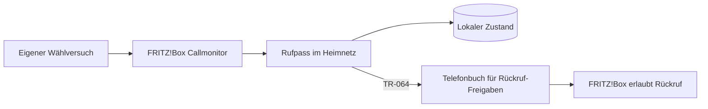

# Rufpass

**Wer von dir angerufen wird, darf zurückrufen.**

Rufpass erkennt selbst gewählte Telefonnummern an der FRITZ!Box und trägt sie für
eine begrenzte Zeit in ein zusätzliches Telefonbuch ein. Mit der vorhandenen
Sperrregel „Nicht im Telefonbuch“ dürfen diese Nummern zurückrufen.

## Warum Rufpass?

Nur Anrufe aus dem Telefonbuch zuzulassen bringt Ruhe vor Werbeanrufen. Es verhindert
aber auch erwünschte Rückrufe: Du rufst eine Werkstatt, Arztpraxis oder einen neuen
Kontakt an, erreichst niemanden und der spätere Rückruf wird blockiert.

Rufpass ergänzt deine vorhandene Positivliste automatisch. Persönliche Kontakte
bleiben erhalten und müssen nicht durch vorübergehende Kontakte ergänzt werden.

## Installation auf Ubuntu

Voraussetzungen: Ubuntu mit Python **3.12 oder neuer**, ein zusätzliches lokales
Telefonbuch, ein FRITZ!Box-Benutzer mit Telefonie-Rechten sowie aktivierter
Callmonitor (`#96*5*`) und Zugriff für Anwendungen (TR-064).

In einem vorhandenen Checkout:

```bash
git pull --ff-only
sudo bash scripts/install.sh
```

Die Ersteinrichtung fragt Host, Benutzer, Telefonbuchname und -ID, Landes-/Ortsvorwahl,
Gültigkeit und Kennwort im lokalen Terminal ab. Voreingestellt sind Telefonbuch
**Rufpass**, ID **1**, Benutzer **rufpass** und **365 Tage** Gültigkeit.

Der Installer prüft die Schnittstellen und startet den systemd-Dienst. Er installiert
Python-Pakete in einer eigenen Umgebung und führt Rufpass unter einem eigenen
Systembenutzer aus. Updates erfolgen mit denselben zwei Befehlen; Konfiguration
und Freigabedaten bleiben erhalten.

Details: [Betrieb auf Ubuntu](docs/operations.md).

## So funktioniert es

1. **Du rufst jemanden an.** Rufpass erkennt den Wählbeginn, auch wenn niemand abnimmt.
2. **Eine Freigabe wird angelegt.** Neue Nummern erscheinen als normale Kontakte im
   zusätzlichen Telefonbuch, mit Datum im Namen: `Rufpass 2026-10-26 Name unbekannt`.
   Vorher werden alle lesbaren FRITZ!Box-Telefonbücher abgeglichen. Bereits bekannte
   Nummern werden nicht zusätzlich angelegt, auch bei unterschiedlicher Schreibweise.
3. **Der Rückruf darf klingeln.** Die FRITZ!Box übernimmt weiterhin die Rufbehandlung.
4. **Die Freigabe läuft ab.** Standardmäßig nach 365 Tagen seit dem letzten eigenen
   Wählversuch. Erneutes Wählen verlängert sie ohne doppelten Eintrag.



Rufpass speichert Wählversuche vor Telefonbuchänderungen in SQLite. Nach Fehlern
gleicht der Dienst seine Kennungen mit dem Telefonbuch ab, bevor er neue Einträge
anlegt. Abgelaufene Kontakte werden nur gelöscht, wenn sie weiterhin eindeutig
zum gespeicherten Rufpass-Eintrag passen. Manuell veränderte Kontakte bleiben erhalten.

Eine externe Namenssuche ist noch nicht angebunden. Neue automatische Kontakte
verwenden daher aktuell `Name unbekannt`. Die Gültigkeit bleibt unabhängig davon gleich.

## Stand und Kompatibilität

**Version 0.2.2:** Automatische Freigaben, Ablaufverwaltung, Wiederanlauf und
Ubuntu-Installer sind implementiert und mit simulierten Schnittstellen getestet.
Der vollständige Dauerbetrieb am Gerät ist noch zu bestätigen.

Am Gerät bestätigt: FRITZ!Box **7690**, FRITZ!OS **8.25**, Ubuntu **24.04.4 LTS**,
Python **3.12.3**. Geprüft wurden das Durchstellen von Nummern aus dem zweiten Buch,
Telefonbuchzugriff, Live-Wählereignisse sowie Anlegen, Rücklesen, Entfernen und
sichtbares Behalten eines Testkontakts. Andere Modelle sind nicht getestet.

Die automatische Nummernaufbereitung ist zunächst auf deutsche Anschlüsse mit
konfigurierter Ortsvorwahl ausgerichtet; internationale Nummern werden mit `+`
oder `00` erkannt. Interne Nummern, Steuercodes, kurze Dienstnummern und ausgewählte
deutsche Sonderrufnummern werden übersprungen. Eine weltweite Rufnummernvalidierung
ist nicht enthalten. Windows-Dienst, Docker-Paket und Weboberfläche gehören nicht
zu dieser Version.

## Rechte, Daten und Grenzen

- Ein FRITZ!Box-Benutzer benötigt Telefonie-Rechte. Diese lassen sich an der Box
  nicht auf ein einzelnes Telefonbuch begrenzen; Rufpass begrenzt seine Schreibzugriffe selbst.
- Der Dienst verwaltet nur eigene Einträge im konfigurierten zusätzlichen Buch.
  Telefonbücher werden niemals komplett ersetzt oder wiederhergestellt.
- Rufnummern und Ablaufdaten liegen lokal in SQLite; Zugangsdaten in einer Datei,
  die nur root und der Dienstbenutzer lesen können. Normale Logs enthalten keine Telefonnummern.
- Erfasst werden nur Telefonate über die überwachte FRITZ!Box. Andere oder unterdrückte
  Rückrufnummern werden dadurch nicht bekannt. Andere vorhandene Rufsperren gelten weiterhin.
- Während Rufpass aus ist, verpasste Wählversuche können nicht nachgeholt werden.
  Bereits gespeicherte Freigaben bleiben bei einem Ausfall bestehen; ihre Bereinigung wartet
  auf den nächsten erfolgreichen Dienstlauf.
- Manuelle Kontakte und frühere `probe --keep`-Testkontakte werden nicht nachträglich
  als automatisch verwaltete Freigaben übernommen.

## Diagnose und Dokumentation

`check` und `monitor` bleiben rein lesend. Automatische Freigaben führt der neue
Befehl `run` aus; der Installer richtet diesen als Dienst ein.

- [Betrieb, Konfiguration und Fehlerbehebung](docs/operations.md)
- [Diagnosebefehle und kontrollierte Schreibtests](docs/diagnostics.md)
- [Architektur](docs/architecture.md)
- [Architekturentscheidung: Python](docs/adr-001-python.md)
- [Recherche und Quellen](docs/research.md)
- [Mitwirken und Tests](CONTRIBUTING.md)

## Autor

Ein Projekt von [Maximilian Glas](https://github.com/maxglas).
Rufpass ist ein unabhängiges Projekt und kein offizielles Produkt von FRITZ!.

## Lizenz

Die Lizenz wird vor der öffentlichen Freigabe festgelegt und als `LICENSE` ergänzt.
