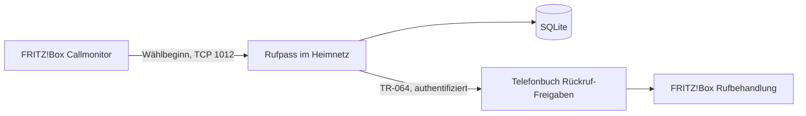

# Architekturentwurf

Status: Vorschlag, noch nicht implementiert oder am Gerät validiert.

## Minimaler Umfang

- Ein Prozess, eine SQLite-Datei, ein dediziertes lokales Telefonbuch.
- Automatisches Wiederverbinden zum Callmonitor nach Verbindungsabbruch.
- Speichern anstehender Änderungen vor Schreibversuchen; Wiederholung bei temporären Fehlern.
- Telefonbuch vor Änderungen abgleichen, um doppelte Einträge nach Abstürzen zu vermeiden.
- Eindeutige Herkunftszuordnung: Nur vom Dienst erzeugte und noch eindeutig zugeordnete Einträge löschen.
- Keine kompletten Telefonbücher ersetzen oder wiederherstellen.
- Vorwahlbehandlung mit Landes- und Ortsvorwahl; interne Nummern, Steuercodes und
  nicht sinnvoll rückrufbare Sondernummern ausschließen. Regeln vor Implementierung festlegen.
- Begrenzte lokale Telefonbuchkapazität berücksichtigen und bei vollem Buch sichtbar Fehler melden.
- Probelauf ohne Schreibzugriffe vor dem Echtbetrieb.
- Zugangsdaten außerhalb von Git; keine Nummern oder Zugangsdaten in normalen Betriebslogs.

## Daten

Pro Freigabe: normalisierte Nummer, letzter eigener Wählversuch, Ablaufzeit,
Telefonbuch-ID, Eintrags-UID und Synchronisationsstatus. Zeitstempel intern in UTC.
Die Laufzeit von 30 Tagen ist ein erster Entwurf und noch nicht endgültig festgelegt.

## Betrieb

Container nur bei bereits vorhandenem Docker Compose, sonst unter Linux systemd.
Kein eingehender Web-Port erforderlich. Der Dienst baut Verbindungen zur Box auf.
Persistentes Datenverzeichnis für SQLite; Neustartregel und Betriebslogs.
MQTT-Statusmeldungen und eine Weboberfläche sind spätere optionale Erweiterungen.

## Abnahme

- Nummer nur im zweiten Telefonbuch wird von der bestehenden Regel zugelassen.
- Wählversuch ohne Annahme erzeugt eine Freigabe.
- Erneutes Wählen verlängert die Freigabe ohne doppelten Eintrag.
- Ablauf entfernt nur den eigenen Eintrag; persönliche Kontakte bleiben erhalten.
- Neustart und erneutes Verbinden erzeugen keine Duplikate.
- TR-064-Ausfall, volles Telefonbuch und ungültige Nummern führen zu sichtbaren Fehlern.
