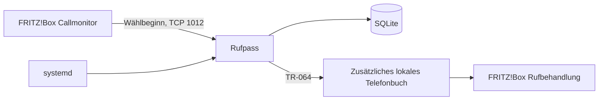

# Architektur

Status: Automatische Freigabe und Linux-Dienst sind implementiert und mit simulierten
Schnittstellen getestet. Die grundlegenden FRITZ!Box-Aktionen und der sichtbare
Testkontakt sind am Gerät bestätigt. Der vollständige Dauerbetrieb ist noch zu prüfen.

## Ablauf

Ein Vordergrundprozess liest Live-Wählereignisse. Er normalisiert externe Zielnummern
mit Landes-/Ortsvorwahl und speichert jeden geeigneten Wählversuch vor dem ersten
Schreibzugriff in SQLite. Das Schema enthält Nummer, eindeutige Kontaktkennung,
letzten Wählzeitpunkt, Ablaufzeit, Eintrags-UID und eine Markierung für neue Wählereignisse.

Der Abgleich liest die Telefonbücher und identifiziert das Zielbuch nach ID und Name.
Alle lesbaren Telefonbücher fließen mit normalisierten Nummern in den Dublettenabgleich ein.
Bei einem Lesefehler wird vor Schreibzugriffen abgebrochen. Vorhandene persönliche
Nummern werden nicht kopiert. Eigene Einträge werden über den vorab gespeicherten
Kontaktnamen, UID, Nummer und einfache Inhaltsprüfung zugeordnet. Gleiche Namen mit
unterschiedlichen Nummern sind erlaubt; bei unklaren Schreibantworten wird die
Kombination aus Name und Nummer abgeglichen. Eine zusätzliche SQLite-Tabelle speichert
die neuen Anzeigenamen, alte Einträge behalten ihre bisherige Zuordnung. Zusätzliche
persönliche Inhalte, geänderte Namen, Nummern oder VIP-Kennzeichnungen führen zur
Abgabe der Verwaltung. Es gibt weder einen Komplettimport noch ein Ersetzen von Büchern.

## Fehler und Wiederanlauf

Unklare Antworten bleiben als lokaler Zustand erhalten. Der nächste Abgleich sucht
den persistierten Namen und die Nummer, bevor ein neuer Eintrag erstellt wird. Abgelaufene eigene
Einträge werden gezielt nach UID gelöscht. Nicht mehr vorhandene Einträge werden
aus dem lokalen Zustand entfernt. Widersprüchliche Kennungen bleiben unangetastet.

Eine Linux-Dateisperre verhindert zwei gleichzeitig schreibende Dienstinstanzen
für dieselbe Datenbank. Die Datenbank ist an Host, Zielbuch-ID und -Name gebunden.
Ein Verlust der Datenbank führt nicht zur automatischen Übernahme alter Telefonbucheinträge.

Callmonitor und TR-064 haben getrennte Verbindungen. Der Monitor verwendet die
Wiederverbindung der Bibliothek; der Hauptprozess startet ihn bei endgültigem Abbruch
erneut. Telefonbuchfehler werden nach 30 Sekunden erneut geprüft. Wählereignisse
während eines Ausfalls oder vor der lokalen Speicherung können verloren gehen.

## Betrieb

Ein systemd-Dienst übernimmt Autostart, Neustart bei Prozessfehlern und Journal-Logs.
Konfiguration liegt unter `/etc/rufpass`, SQLite unter `/var/lib/rufpass`, Python und
Abhängigkeiten unter `/opt/rufpass`. Der Dienst hat einen eigenen Benutzer und
Schreibzugriff nur auf seinen Zustandsbereich. Kein eingehender Web-Port erforderlich.

Die erste vollständige Version zielt auf Ubuntu mit Python 3.12. Deutsche Orts- und
Landesvorwahlen sind die zuerst unterstützte Nummernkonvention. Docker, MQTT und
eine Weboberfläche sind keine Voraussetzungen und werden derzeit nicht mitgeliefert.
